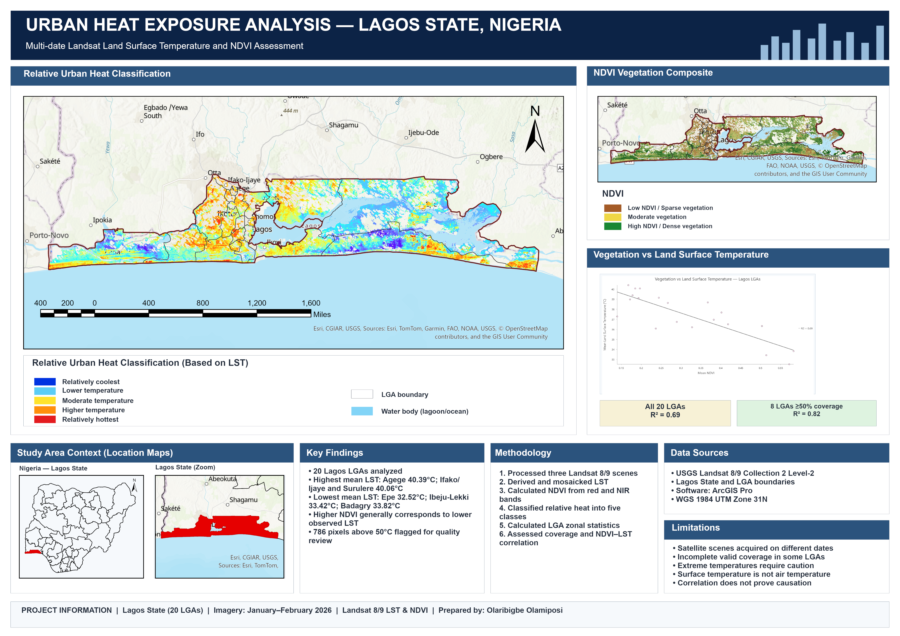
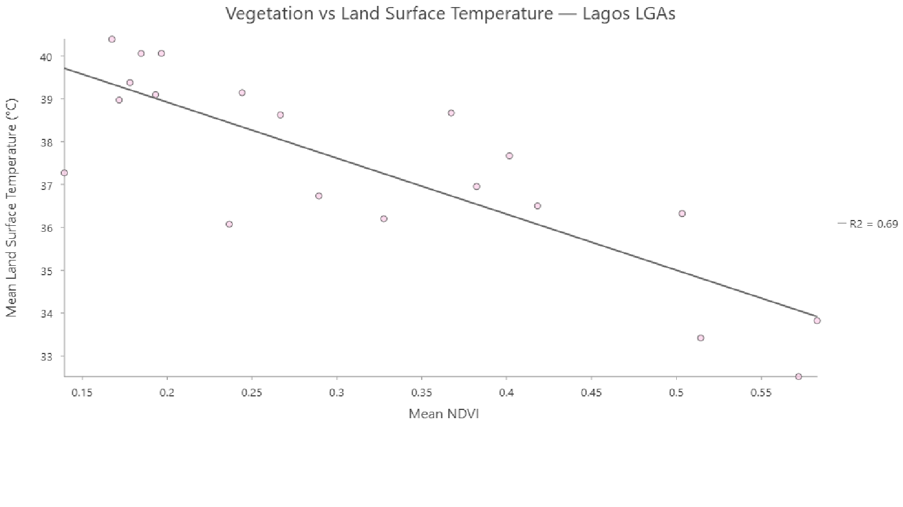
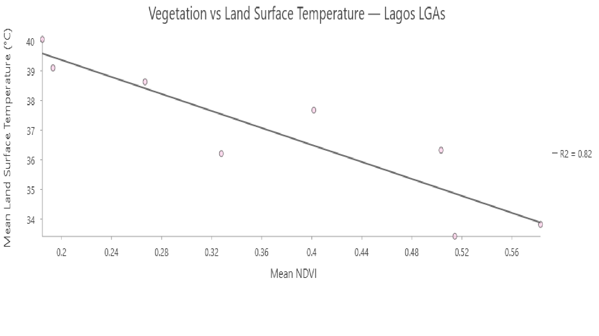

# Urban Heat Exposure Analysis — Lagos State, Nigeria

**Mapping Land Surface Temperature, Vegetation Distribution, and Spatial Heat Patterns Using Landsat 8/9 and ArcGIS Pro**

**Author:** Olaribigbe Olamiposi  
**Study Area:** Lagos State, Nigeria  
**Software:** ArcGIS Pro  
**Satellite Data:** Landsat 8/9 Collection 2 Level-2  
**Analysis Period:** January–February 2026

---

## 1. Project Overview

Urbanization, vegetation loss, and land-cover changes can influence surface-temperature patterns in rapidly developing cities.

This project investigates the spatial distribution of **Land Surface Temperature (LST)** and vegetation cover across Lagos State, Nigeria, using Landsat 8/9 satellite imagery and Geographic Information Systems (GIS).

The analysis focuses on the state's **20 Local Government Areas (LGAs)** and examines how observed surface temperatures vary spatially and relate to vegetation conditions measured using the **Normalized Difference Vegetation Index (NDVI)**.

The study integrates satellite remote sensing, raster analysis, zonal statistics, vegetation assessment, and cartographic visualization to provide insights into relative urban heat patterns across Lagos State.

## 2. Final Urban Heat Exposure Map

**[View the full-resolution A3 map (PDF)](04_Exports/Lagos_Urban_Heat_Exposure_Final_A3.pdf)**

The final A3 landscape map presents relative heat classifications, NDVI vegetation distribution, the vegetation–temperature relationship, key findings, and study-area location maps.

## 3. Project Objectives

The objectives of this analysis are to:

- Map the spatial distribution of land surface temperature across Lagos State.
- Analyze vegetation distribution using NDVI.
- Classify observed surface temperatures into five relative heat categories.
- Compare mean land surface temperatures across the 20 Lagos LGAs.
- Investigate the relationship between vegetation cover and surface temperature.
- Evaluate valid satellite-data coverage and identify potential quality limitations.
- Produce a professional thematic map communicating the analytical findings.

## 4. Study Area

**Location:** Lagos State, southwestern Nigeria  
**Administrative Units:** 20 Local Government Areas  
**Coordinate Reference System:** WGS 1984 UTM Zone 31N

Lagos State contains a mixture of densely built-up urban areas, industrial zones, coastal environments, wetlands, lagoons, and vegetated landscapes.

These varying land-cover characteristics make Lagos a relevant study area for examining spatial differences in observed surface temperatures and vegetation distribution.

## 5. Data Sources and Software

| Data / Tool | Description |
|---|---|
| Landsat 8/9 Collection 2 Level-2 | Satellite surface-temperature and reflectance products |
| ST_B10 | Landsat surface-temperature band |
| SR_B4 | Red surface-reflectance band |
| SR_B5 | Near-infrared surface-reflectance band |
| QA_PIXEL | Pixel quality-assurance information |
| Lagos State boundary | Study-area boundary |
| Lagos LGA boundaries | Administrative units for zonal analysis |
| ArcGIS Pro | Raster processing, spatial analysis, statistics, and cartography |

**Satellite acquisition dates:**

- 28 January 2026 — Landsat 9
- 5 February 2026 — Landsat 8
- 6 February 2026 — Landsat 9

The scenes were combined to produce multi-date temperature and vegetation composites covering Lagos State.

## 6. Methodology

### 6.1 Satellite Data Preparation

Three Landsat 8/9 Collection 2 Level-2 scenes were acquired for the Lagos State study area.

Relevant surface-temperature, surface-reflectance, and quality-assurance bands were extracted and prepared for analysis in ArcGIS Pro.

### 6.2 Land Surface Temperature Analysis

Landsat surface-temperature data were converted to degrees Celsius using the Collection 2 Level-2 scale factor and offset.

The conversion followed:

**LST (°C) = (ST_B10 × 0.00341802 + 149.0) − 273.15**

The individual temperature rasters were clipped to the Lagos State boundary and mosaicked using the mean method to produce a multi-date LST composite.

### 6.3 NDVI Calculation

The Normalized Difference Vegetation Index was calculated using the red and near-infrared surface-reflectance bands.

**NDVI = (NIR − Red) / (NIR + Red)**

Landsat reflectance scaling and quality masking were applied during processing.

The resulting NDVI scenes were clipped to Lagos State and combined into a multi-date vegetation composite.

### 6.4 Relative Heat Classification

The composite LST raster was classified into five categories using an equal-area classification approach.

| Class | Relative Temperature Category |
|---|---|
| 1 | Relatively coolest |
| 2 | Lower temperature |
| 3 | Moderate temperature |
| 4 | Higher temperature |
| 5 | Relatively hottest |

The classification identifies relative surface-temperature patterns rather than absolute heat-health risk categories.

### 6.5 LGA-Level Zonal Statistics

Zonal statistics were calculated for the 20 LGAs to derive observed temperature and vegetation characteristics.

The analysis included:

- Mean land surface temperature
- Minimum and maximum observed temperatures
- Mean NDVI
- Valid-data pixel counts and coverage percentages
- LGA-level comparisons

Coverage percentages were calculated to assess the completeness of satellite observations within each LGA.

### 6.6 Vegetation–Temperature Correlation

Scatter plots and linear trendlines were used to investigate the relationship between mean NDVI and mean LST.

Two analyses were conducted:

1. All 20 Lagos LGAs.
2. Eight LGAs with at least 50% valid coverage for both LST and NDVI.

The comparison helped evaluate how incomplete satellite coverage might affect the observed statistical relationship.

### 6.7 Temperature Quality Review

A threshold-based raster analysis identified composite temperature pixels exceeding 50°C.

These pixels were examined spatially to identify locations requiring additional caution during interpretation.

## 7. Key Findings

### 7.1 Land Surface Temperature

The analysis revealed spatial variation in observed surface temperatures across Lagos State.

**Selected LGAs with the highest observed mean LST:**

| LGA | Mean LST |
|---|---:|
| Agege | 40.39°C |
| Ifako/Ijaye | 40.06°C |
| Surulere | 40.06°C |

**Selected LGAs with the lowest observed mean LST:**

| LGA | Mean LST |
|---|---:|
| Epe | 32.52°C |
| Ibeju-Lekki | 33.42°C |
| Badagry | 33.82°C |

These values represent observed LGA means from the available valid pixels. They should not be interpreted as complete, simultaneous temperature measurements of every location within each LGA.

### 7.2 Vegetation Distribution

The NDVI analysis showed differences in vegetation cover across Lagos State.

Selected higher observed mean NDVI values included:

- Badagry — approximately 0.583
- Epe — approximately 0.572
- Ibeju-Lekki — approximately 0.514

Selected lower observed mean NDVI values included:

- Lagos Island — approximately 0.139
- Agege — approximately 0.168
- Shomolu — approximately 0.172

These results indicate differences in observed vegetation conditions between more vegetated and densely developed areas.

### 7.3 NDVI–LST Relationship

The analysis identified an inverse association between vegetation cover and observed land surface temperature.

| Analysis | R² |
|---|---:|
| All 20 Lagos LGAs | 0.69 |
| Eight LGAs with ≥50% valid coverage | 0.82 |

The stronger relationship in the coverage-filtered subset highlights the importance of considering data completeness when interpreting satellite-derived statistics.

**Correlation analysis — All 20 LGAs**

**Correlation analysis — Eight LGAs with sufficient valid coverage**

These results describe statistical association. They do not establish that vegetation alone causes the observed temperature differences.

### 7.4 High-Temperature Quality Assessment

A threshold-based review identified **786 raster pixels with composite LST values above 50°C**.

These observations were retained for quality assessment.

The presence of extreme values does not independently establish whether they represent genuine surface temperatures or possible satellite-processing artifacts.

## 8. Limitations

Several limitations should be considered when interpreting the findings:

- **Temporal differences:** The three Landsat scenes were acquired on different dates. The resulting composites do not represent one simultaneous observation across Lagos State.
- **Incomplete data coverage:** Cloud masking and missing satellite observations resulted in different valid-data coverage percentages across LGAs.
- **Extreme values:** Some high-temperature pixels require further validation before being interpreted as confirmed hotspots.
- **Surface versus air temperature:** Landsat LST represents observed surface conditions, not ambient air temperature.
- **Relative classification:** The five heat categories are relative spatial classes, not established human heat-risk thresholds.
- **Correlation:** The NDVI–LST relationship does not establish causation.

These limitations are particularly important when comparing LGAs with substantially different valid-data coverage.

## 9. Project Deliverables

The repository contains the final cartographic outputs, correlation charts, editable ArcGIS Pro layout, and methodology documentation.

| File | Description |
|---|---|
| [Final A3 Map — PDF](04_Exports/Lagos_Urban_Heat_Exposure_Final_A3.pdf) | Print-ready landscape map |
| [Final A3 Map — PNG](04_Exports/Lagos_Urban_Heat_Exposure_Final_A3.png) | High-resolution map visualization |
| [Editable ArcGIS Pro Layout](04_Exports/Lagos%20Urban%20Heat%20Exposure%20-%20A3%20Landscape.pagx) | ArcGIS Pro page layout file |
| [NDVI–LST Chart — 20 LGAs](04_Exports/Charts/Lagos_NDVI_LST_Correlation.png) | Full LGA correlation analysis |
| [NDVI–LST Chart — 8 LGAs](04_Exports/Charts/Lagos_NDVI_LST_Correlation_8LGAs.png) | Coverage-filtered correlation analysis |
| [Methodology Documentation](05_Documentation/Urban_Heat_Exposure_Methodology.md) | Detailed GIS processing workflow and results |

The full raw satellite datasets and processed geodatabase are not included in this repository.

## 10. Conclusion

This project demonstrates the application of satellite remote sensing and GIS in examining spatial variations in land surface temperature and vegetation distribution across Lagos State.

The findings reveal differences in observed surface temperatures among LGAs and an inverse association between vegetation cover and land surface temperature.

The analysis also highlights the importance of considering satellite acquisition dates, valid-data coverage, and temperature quality when interpreting remotely sensed environmental conditions.

The resulting maps, statistics, and correlation assessments provide a spatial perspective on urban surface-temperature patterns in Lagos State.

## 11. Author

**Olaribigbe Olamiposi**

**Project:** Urban Heat Exposure Analysis — Lagos State, Nigeria

**Tools:** ArcGIS Pro, Landsat 8/9, GIS and Remote Sensing

**Year:** 2026

---

*Data source: USGS Landsat 8/9 Collection 2 Level-2. Analysis and cartographic production completed using ArcGIS Pro.*
